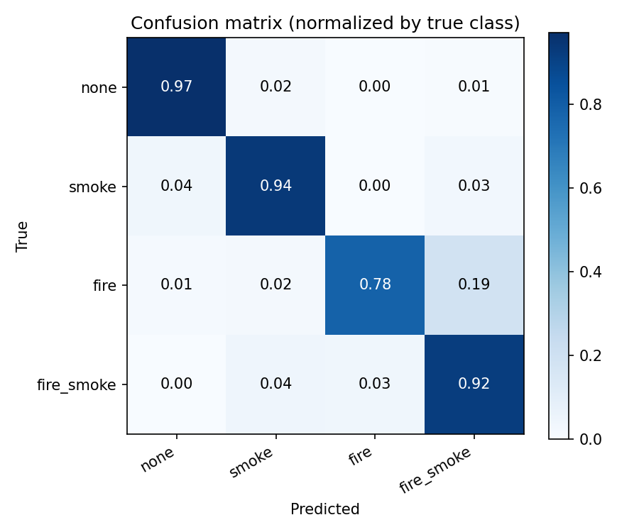
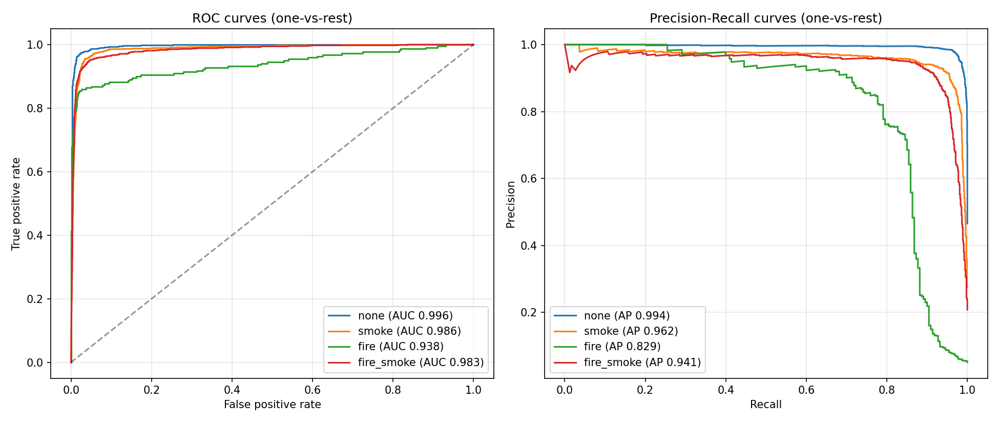
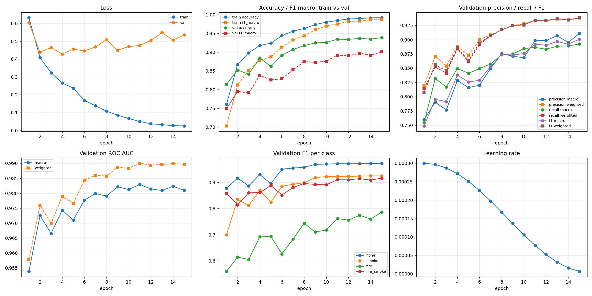
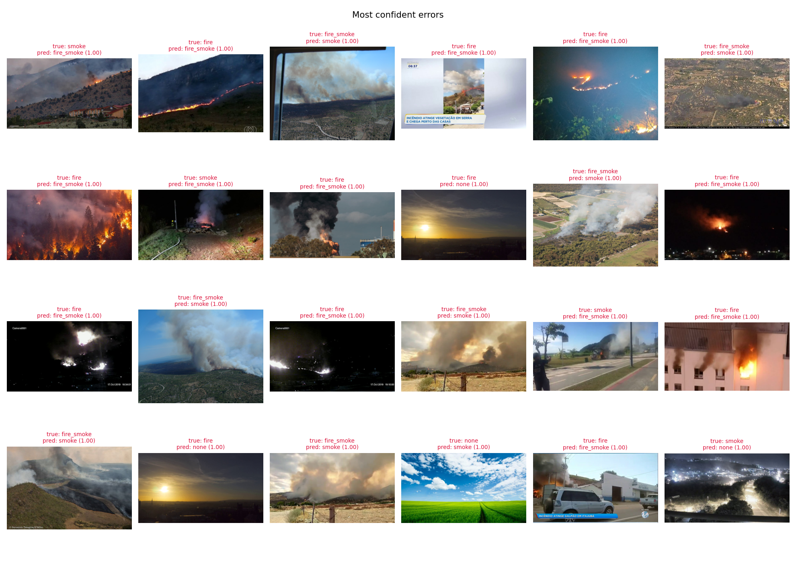

# D-Fire: Fire and Smoke Image Classification — ResNet18 Baseline

Image-level classification of the [D-Fire dataset](https://www.kaggle.com/datasets/shubhamkarande13/d-fire)
into 4 classes with an ImageNet-pretrained ResNet18.

**Baseline result (test set, 4306 images):** accuracy **0.941**, F1 macro **0.907**, F1 weighted **0.941**,
ROC AUC macro **0.976**.

---

## 1. Repository structure

```
.
├── config.py            # all hyperparameters and paths (auto-switch Kaggle / local)
├── main.py              # entry point: data → model → training → evaluation on val and test
├── data.py              # YOLO txt → 4 classes, train/val split, augmentations, Dataset / DataLoader
├── model.py             # torchvision ResNet with a new 4-class head
├── train.py             # training epoch, inference, fit loop (checkpoints, early stopping, logs)
├── utils.py             # seed, logger, metrics, plots, reports
├── check_data.py        # dataset sanity check: class distribution + bounding box preview
├── predict.py           # evaluate a saved checkpoint / predict on custom images
├── requirements.txt
└── experiment/
    ├── baseline.ipynb               # Kaggle notebook used for the run (with outputs)
    └── results/
        ├── resnet18_224/            # main experiment: logs, metrics, plots, predictions
        └── resnet18_224_debug/      # pipeline sanity check (128 images per split, 1 epoch)
```

## 2. Pipeline

### 2.1 Labels: YOLO annotations → 4 classes

D-Fire is a detection dataset: every image has a YOLO `.txt` file with one line per object
(`class_id x_center y_center width height`), where `0 = smoke` and `1 = fire`.
An image-level class is derived from the set of class ids present in the file:

| id | class | rule |
|---|---|---|
| 0 | `none` | empty or missing `.txt` |
| 1 | `smoke` | only `0` |
| 2 | `fire` | only `1` |
| 3 | `fire_smoke` | both `0` and `1` |

The dataset folder is searched recursively inside `paths.data_root`; both
`train/images + train/labels` and `images/train + labels/train` layouts are supported.
`check_data.py` prints the class distribution and saves `data_check.png` with example boxes
to verify the `0 = smoke`, `1 = fire` mapping.

### 2.2 Data

- **Split:** the official D-Fire `train` set is split into train / val (85% / 15%, stratified by class, seed 42);
  the official `test` set is used only for final evaluation.
- **Train augmentations:** `RandomResizedCrop(224, scale=(0.7, 1.0))`, horizontal flip,
  `ColorJitter(brightness=0.2, contrast=0.2, saturation=0.1)`; hue is not changed because color is a key cue for fire.
- **Eval preprocessing:** resize to 224×224.
- **Normalization:** ImageNet mean / std.

### 2.3 Model

`torchvision.models.resnet18` with ImageNet weights (`IMAGENET1K_V1`). The final `fc` layer (512 → 1000) is
replaced by a new `Linear(512 → 4)`; all layers are fine-tuned.

| stage | output (C×H×W) | parameters |
|---|---|---|
| conv1 7×7/2 + BN + ReLU, maxpool 3×3/2 | 64×56×56 | 9.5K |
| layer1: 2 × BasicBlock | 64×56×56 | 148K |
| layer2: 2 × BasicBlock | 128×28×28 | 526K |
| layer3: 2 × BasicBlock | 256×14×14 | 2.1M |
| layer4: 2 × BasicBlock | 512×7×7 | 8.4M |
| global average pooling | 512 | — |
| fc | 4 logits | 2K |
| **total** | | **11.18M** |

BasicBlock: `Conv3×3 → BN → ReLU → Conv3×3 → BN → (+ shortcut) → ReLU`. The shortcut is the identity, or a
`Conv1×1/2 + BN` projection when the resolution and channel count change. Hidden activation: **ReLU**.
The output is raw logits; softmax is applied inside the loss and at inference.

### 2.4 Training

| setting | value |
|---|---|
| loss | cross-entropy with class weights `w_c = N / (K · n_c)` |
| optimizer | AdamW, lr 3e-4, weight decay 1e-4 |
| LR schedule | cosine annealing to lr / 100 over all epochs |
| epochs / batch size | 15 / 64 |
| mixed precision | yes (`torch.autocast` + `GradScaler`) |
| checkpoint selection | best val F1 macro (`best.pt`), plus `last.pt` |
| early stopping | 5 epochs without val F1 macro improvement |

### 2.5 Evaluation and outputs

After training, `best.pt` is evaluated on val and test. Metrics: accuracy, precision, recall, F1 and
ROC AUC (one-vs-rest), each in **macro** and **weighted** averaging, plus per-class precision / recall / F1 /
ROC AUC / average precision and the confusion matrix.

Each run writes to `outputs/<exp_name>/` (and `outputs/<exp_name>.zip`):

| file | content |
|---|---|
| `train.log` | full log: system info, config, class distribution, per-N-steps loss / lr / throughput, per-epoch train and val metrics with per-class table, final evaluation |
| `log.csv` | all metrics per epoch |
| `training_curves.png` | loss, accuracy / F1 (train vs val), val precision / recall / F1, ROC AUC, per-class F1, learning rate |
| `config.yaml`, `summary.json` | run configuration and final metrics |
| `class_distribution.csv`, `labels.csv` | class counts per split; split and label for every image |
| `{val,test}_report.txt` | all metrics, per-class table and confusion matrix (human-readable) |
| `{val,test}_metrics.json`, `{val,test}_per_class.csv`, `{val,test}_confusion_matrix.csv` | the same, machine-readable |
| `{val,test}_confusion_matrix.png`, `{val,test}_confusion_matrix_norm.png` | confusion matrix (counts, row-normalized) |
| `{val,test}_roc_pr_curves.png` | one-vs-rest ROC and precision-recall curves |
| `{val,test}_errors.png` | 24 most confident misclassifications |
| `{val,test}_predictions.csv` | prediction and class probabilities for every image |
| `best.pt`, `last.pt` | checkpoints (weights + config + class names) |

`outputs/results.csv` gets one row per run for comparing experiments.

### 2.6 How to run

```bash
pip install -r requirements.txt
python check_data.py                                     # verify dataset and label mapping
python main.py general.debug=true                        # quick sanity run: 128 images per split, 1 epoch
python main.py                                           # full run with config.py defaults
python main.py general.exp_name=r18_320 data.img_size=320 training.epochs=20   # override any parameter
```

Any parameter from `config.py` can be overridden as `section.key=value`; an unknown key raises an error.

**Kaggle** (dataset added via *Add Input*, *Accelerator: GPU*, *Internet: On*):

```python
!git clone -q -b baseline https://github.com/VladislavZherikhov/DLCV_course_project.git /kaggle/working/repo
%cd /kaggle/working/repo
!pip install -q omegaconf
!python check_data.py
!python -u main.py general.exp_name=resnet18_224
```

The exact notebook used for the experiment is [`experiment/baseline.ipynb`](experiment/baseline.ipynb).

**Evaluate a checkpoint locally / predict on custom images:**

```bash
python predict.py --ckpt outputs/resnet18_224/best.pt --data_root /path/to/D-Fire --split test
python predict.py --ckpt outputs/resnet18_224/best.pt --images my_photos/
```

---

## 3. Experiment: `resnet18_224`

### 3.1 Setup

| | |
|---|---|
| environment | Kaggle notebook, 1 × NVIDIA Tesla T4 (16 GB), Python 3.13, PyTorch 2.11 (CUDA 12.8) |
| configuration | defaults from `config.py` (see [`config.yaml`](experiment/results/resnet18_224/config.yaml)) |
| training time | 29 min 15 s for 15 epochs × 228 steps (~85 s per epoch; the first epoch took 554 s due to cold reads from `/kaggle/input`) |
| peak GPU memory | 0.93 GB |
| best checkpoint | epoch 15 (last epoch) |

### 3.2 Data

The label mapping was verified with `check_data.py`: images with only `class id 0` boxes contain smoke,
images with only `class id 1` boxes contain fire.

| class | train | val | test | test share |
|---|---|---|---|---|
| `none` | 6658 | 1175 | 2005 | 46.6% |
| `smoke` | 3979 | 702 | 1186 | 27.5% |
| `fire` | 802 | 142 | 220 | 5.1% |
| `fire_smoke` | 3198 | 565 | 895 | 20.8% |
| **total** | **14637** | **2584** | **4306** | |

The dataset is imbalanced: `fire` makes up only ~5% of the images. The resulting loss weights were
`none` 0.55, `smoke` 0.92, `fire` 4.56, `fire_smoke` 1.14.

### 3.3 Overall metrics (best checkpoint)

| metric | val | test |
|---|---|---|
| accuracy | 0.9385 | **0.9408** |
| precision macro | 0.9109 | 0.9116 |
| recall macro | 0.8922 | 0.9018 |
| **F1 macro** | 0.9007 | **0.9065** |
| ROC AUC macro | 0.9810 | 0.9757 |
| precision weighted | 0.9380 | 0.9407 |
| recall weighted | 0.9385 | 0.9408 |
| **F1 weighted** | 0.9380 | **0.9406** |
| ROC AUC weighted | 0.9897 | 0.9875 |

Val and test results agree closely, so the val split is a reliable proxy for the test set.

### 3.4 Per-class metrics (test)

| class | precision | recall | F1 | ROC AUC | avg. precision | support |
|---|---|---|---|---|---|---|
| `none` | 0.9759 | 0.9711 | 0.9735 | 0.9958 | 0.9944 | 2005 |
| `smoke` | 0.9273 | 0.9359 | 0.9316 | 0.9861 | 0.9618 | 1186 |
| `fire` | 0.8390 | 0.7818 | **0.8094** | 0.9381 | 0.8292 | 220 |
| `fire_smoke` | 0.9043 | 0.9184 | 0.9113 | 0.9828 | 0.9413 | 895 |

### 3.5 Confusion matrix (test)

| true \ predicted | `none` | `smoke` | `fire` | `fire_smoke` |
|---|---|---|---|---|
| `none` | **1947** | 43 | 2 | 13 |
| `smoke` | 43 | **1110** | 0 | 33 |
| `fire` | 3 | 4 | **172** | 41 |
| `fire_smoke` | 2 | 40 | 31 | **822** |



255 of 4306 test images are misclassified. The main error types are:

- **`fire` ↔ `fire_smoke`** (41 + 31 errors). This is the weakest point: 18.6% of `fire` images are predicted
  as `fire_smoke`. Fire is almost always accompanied by some smoke, and the boundary between the two classes
  depends on whether faint smoke was annotated.
- **`smoke` ↔ `none`** (43 + 43). Thin or distant smoke is confused with haze, fog and clouds.
- **`smoke` ↔ `fire_smoke`** (33 + 40). Small or occluded flames inside large smoke plumes are missed or hallucinated.
- Confusions between `fire` and `none` are almost absent (5 images in total).

Derived from the same matrix, the model works well as a binary alarm (**fire or smoke present** vs `none`):
recall 0.979 (2253 / 2301), precision 0.975 (2253 / 2311). Detecting **any fire** (`fire` or `fire_smoke`)
gives recall 0.956 and precision 0.957.



### 3.6 Training dynamics

| epoch | train loss | train acc | val loss | val acc | val F1 macro | val F1 `fire` |
|---|---|---|---|---|---|---|
| 1 | 0.631 | 0.761 | 0.603 | 0.814 | 0.749 | 0.559 |
| 4 | 0.266 | 0.918 | **0.428** | 0.884 | 0.838 | 0.691 |
| 8 | 0.108 | 0.963 | 0.508 | 0.917 | 0.875 | 0.744 |
| 11 | 0.050 | 0.984 | 0.476 | 0.934 | 0.892 | 0.762 |
| 15 | 0.026 | 0.992 | 0.534 | **0.939** | **0.901** | **0.787** |



- **Val F1 and accuracy keep improving until the last epoch**, while the learning rate decays to almost zero.
  The best checkpoint is the final one.
- **Val loss reaches its minimum at epoch 4 and then grows**, while train loss goes to ~0.03 and train accuracy to 0.99.
  The model keeps getting more accurate but becomes **over-confident**: the most confident test errors have
  probability ≈ 1.00. This is a sign of overfitting in terms of calibration rather than accuracy.
- `fire` is the slowest and noisiest class to learn, which matches its small size (802 training images).

### 3.7 Error analysis



Many of the most confident errors appear to be **annotation ambiguity** rather than model failures.
Examples: images labelled `fire` with clearly visible smoke and predicted as `fire_smoke`; images labelled `smoke`
with visible flames; sunsets labelled `fire`. The rest are hard cases: night scenes with small light sources,
distant smoke, and clouds that look like smoke.

### 3.8 Conclusions and next steps

The ResNet18 baseline achieves **0.941 accuracy / 0.907 F1 macro** on the D-Fire test set. It reliably separates
"something is burning" from "nothing" (≈ 0.98 recall / precision). The main difficulty is the fine-grained
`fire` vs `fire_smoke` distinction for the rare `fire` class.

Possible improvements:

1. **Higher input resolution** (`data.img_size=320/384`): small and distant fire and smoke get lost at 224×224,
   since the final feature map is only 7×7.
2. **Regularization against over-confidence:** label smoothing, stronger augmentations (e.g. mixup/cutmix),
   larger weight decay.
3. **Larger or more modern backbones:** ResNet50, EfficientNet, ConvNeXt.
4. **Longer training:** val metrics were still improving at epoch 15.
5. **Threshold tuning / multi-label formulation:** predicting `fire` and `smoke` as two independent binary outputs
   naturally matches how the 4 classes are built.

Model checkpoints (`*.pt`, ~45 MB each) are not tracked by git.
