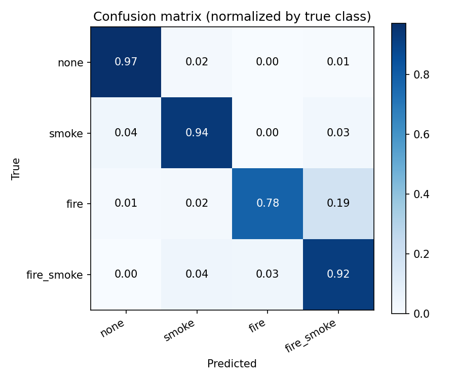
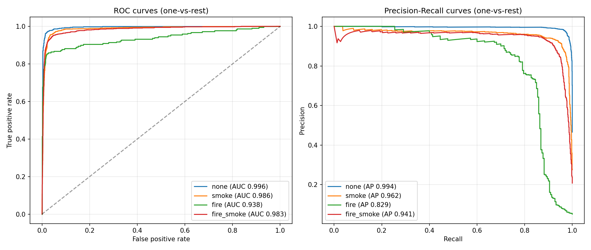
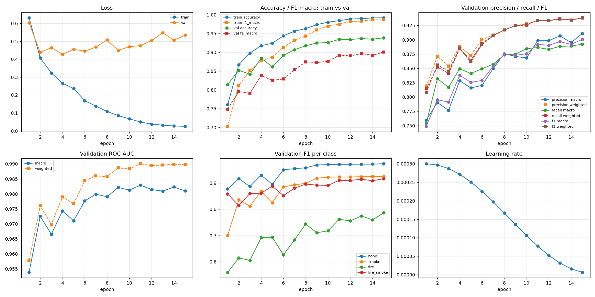
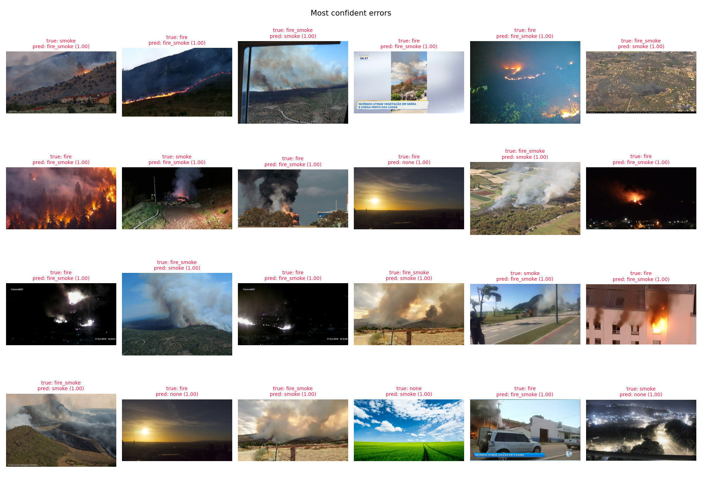

# D-Fire: Fire and Smoke Image Classification

Image-level classification of the [D-Fire dataset](https://www.kaggle.com/datasets/shubhamkarande13/d-fire)
into 4 classes (`none`, `smoke`, `fire`, `fire_smoke`) with ImageNet-pretrained CNNs.

| experiment | model | input | test accuracy | test F1 macro | test F1 `fire` | test ROC AUC macro |
|---|---|---|---|---|---|---|
| [1. Baseline](#3-experiment-1-resnet18-baseline) | ResNet18 | 224 | **0.9408** | **0.9065** | **0.8094** | 0.9757 |
| [2. CBAM](#4-experiment-2-resnet18--cbam) | ResNet18 + CBAM | 224 | 0.9322 | 0.8898 | 0.7636 | **0.9792** |
| [3. ConvNeXt](#5-experiment-3-convnext-tiny) | ConvNeXt-Tiny | 384 | *pending* | | | |

---

## 1. Repository structure

```
.
├── config.py            # all hyperparameters and paths (auto-switch Kaggle / local)
├── main.py              # entry point: data → model → training → evaluation on val and test
├── data.py              # YOLO txt → 4 classes, train/val split, augmentations, Dataset / DataLoader
├── model.py             # ConvNeXt / ResNet backbones with a new 4-class head, optional CBAM for ResNet
├── train.py             # training epoch, inference, fit loop (checkpoints, early stopping, logs)
├── utils.py             # seed, logger, metrics, plots, reports
├── check_data.py        # dataset sanity check: class distribution + bounding box preview
├── predict.py           # evaluate a saved checkpoint / predict on custom images
├── requirements.txt
└── experiment/
    ├── baseline.ipynb                       # Kaggle notebook of experiment 1 (with outputs)
    ├── cbam_pipeline.ipynb                  # Kaggle notebook of experiment 2 (with outputs)
    └── results/
        ├── baseline_resnet18_224/           # experiment 1: logs, metrics, plots, predictions
        ├── cbam_pipeline_resnet18_224/      # experiment 2
        └── resnet18_224_debug/              # pipeline sanity check (128 images per split, 1 epoch)
```

## 2. Pipeline

### 2.1 Labels: YOLO annotations → 4 classes

D-Fire is a detection dataset: every image has a YOLO `.txt` file with one line per object
(`class_id x_center y_center width height`), where `0 = smoke` and `1 = fire`.
An image-level class is derived from the set of class ids present in the file:

| id | class | rule |
|---|---|---|
| 0 | `none` | empty or missing `.txt` |
| 1 | `smoke` | only `0` |
| 2 | `fire` | only `1` |
| 3 | `fire_smoke` | both `0` and `1` |

The dataset folder is searched recursively inside `paths.data_root`; both
`train/images + train/labels` and `images/train + labels/train` layouts are supported.
`check_data.py` prints the class distribution and saves `data_check.png` with example boxes
to verify the `0 = smoke`, `1 = fire` mapping.

### 2.2 Data

- **Split:** the official D-Fire `train` set is split into train / val (85% / 15%, stratified by class, seed 42);
  the official `test` set is used only for final evaluation.
- **Train augmentations:** `RandomResizedCrop(S, scale=(0.7, 1.0))`, horizontal flip,
  `ColorJitter(brightness=0.2, contrast=0.2, saturation=0.1)`; hue is not changed because color is a key cue for fire.
- **Eval preprocessing:** resize to S×S.
- **Normalization:** ImageNet mean / std.
- Input size S (`data.img_size`): 224 for the ResNet18 experiments, 384 for ConvNeXt-Tiny.
- Augmentation is applied on the fly: the training set size does not change (14 637 images).

### 2.3 Models

All backbones come from `torchvision` with ImageNet-1K weights; the classification head is replaced by a new
4-class linear layer and the whole network is fine-tuned. The output is raw logits; softmax is applied inside the
loss and at inference.

#### 2.3.1 ConvNeXt-Tiny (`model.name=convnext_tiny`, default)

[A ConvNet for the 2020s](https://arxiv.org/abs/2201.03545) (Liu et al., CVPR 2022) modernizes the ResNet design with
ideas from vision transformers: a patchify stem, large 7×7 depthwise kernels, an inverted bottleneck, LayerNorm
instead of BatchNorm, GELU instead of ReLU, fewer normalization / activation layers, and separate downsampling layers.
Weights `IMAGENET1K_V1` (82.5% ImageNet top-1, vs 69.8% for ResNet18).

| stage | output at 384×384 (C×H×W) | blocks | parameters |
|---|---|---|---|
| stem: Conv 4×4/4 + LayerNorm | 96×96×96 | — | 4.9K |
| stage 1 | 96×96×96 | 3 | 238K |
| downsample: LayerNorm + Conv 2×2/2 | 192×48×48 | — | 74K |
| stage 2 | 192×48×48 | 3 | 918K |
| downsample | 384×24×24 | — | 296K |
| stage 3 | 384×24×24 | 9 | 10.8M |
| downsample | 768×12×12 | — | 1.2M |
| stage 4 | 768×12×12 | 3 | 14.3M |
| global average pooling → LayerNorm → Linear(768 → 4) | 4 logits | — | 4.6K |
| **total** | | **18** | **27.8M** |

ConvNeXt block: `DWConv 7×7 → LayerNorm → Linear(C → 4C) → GELU → Linear(4C → C) → layer scale → stochastic depth → (+ x)`.
Stochastic depth (drop path) grows linearly up to 0.1 in the last block.

At 384×384 the final feature map is 12×12 instead of 7×7 for ResNet18 at 224, which preserves small and distant
fire / smoke. Cost: 13.1 GMACs per image vs 1.8 for ResNet18 at 224.

#### 2.3.2 ResNet18 (`model.name=resnet18`)

Weights `IMAGENET1K_V1`; the final `fc` layer (512 → 1000) is replaced by `Linear(512 → 4)`.

| stage | output at 224×224 (C×H×W) | parameters |
|---|---|---|
| conv1 7×7/2 + BN + ReLU, maxpool 3×3/2 | 64×56×56 | 9.5K |
| layer1: 2 × BasicBlock | 64×56×56 | 148K |
| layer2: 2 × BasicBlock | 128×28×28 | 526K |
| layer3: 2 × BasicBlock | 256×14×14 | 2.1M |
| layer4: 2 × BasicBlock | 512×7×7 | 8.4M |
| global average pooling | 512 | — |
| fc | 4 logits | 2K |
| **total** | | **11.18M** |

BasicBlock: `Conv3×3 → BN → ReLU → Conv3×3 → BN → (+ shortcut) → ReLU`. The shortcut is the identity, or a
`Conv1×1/2 + BN` projection when the resolution and channel count change. Hidden activation: ReLU.

#### 2.3.3 CBAM attention for ResNet (`model.attention=cbam`)

[CBAM: Convolutional Block Attention Module](https://arxiv.org/abs/1807.06521) (Woo et al., ECCV 2018) refines a
feature map `F` with two sequential attention masks:

- **Channel attention**, *which* features matter: `M_c = σ(MLP(AvgPool(F)) + MLP(MaxPool(F)))`, one weight per channel
  (shared 2-layer MLP with reduction ratio 16);
- **Spatial attention**, *where* to look: `M_s = σ(Conv7×7([mean_c(F); max_c(F)]))`, one weight per spatial position;
- `F' = F ⊗ M_c`, then `F'' = F' ⊗ M_s`.

As in the paper, a CBAM module is inserted into **every residual block**, after the last BN and before the addition
with the shortcut: `Conv → BN → ReLU → Conv → BN → CBAM → (+ shortcut) → ReLU`.
For ResNet18 this gives 8 modules and +89.9K parameters (+0.8%).

**Fine-tuning a pretrained backbone.** There are no ImageNet weights for ResNet18 + CBAM, so the modules are trained
from scratch inside a pretrained network. With the original formulation the masks start at `σ(·) ≈ 0.5`, which scales
every block's features by ≈ 0.25 and disrupts the pretrained representations. Two changes avoid this:

- **identity initialization** (`model.cbam.identity_init=true`): the last layer of each attention branch is zero-initialized
  and the masks are computed as `2·σ(z)`, so at the start both masks equal exactly 1 and the network is identical
  to the baseline (`identity_init=false` restores the paper's formulation);
- **separate learning rate**: CBAM parameters use `lr × training.attention_lr_mult` (×10 by default).

### 2.4 Training

| setting | ResNet18 (± CBAM) | ConvNeXt-Tiny (default) |
|---|---|---|
| loss | cross-entropy with class weights `w_c = N / (K · n_c)` | same |
| optimizer | AdamW, lr 3e-4, weight decay 1e-4 on all parameters (CBAM: lr × 10) | AdamW, lr 1e-4, weight decay 0.05; no weight decay on biases, norm weights and layer scale |
| LR schedule | cosine annealing to lr / 100 over all epochs | same |
| epochs / batch size | 15 / 64 | 15 / 32 |
| input size | 224 | 384 |
| mixed precision | yes (`torch.autocast` + `GradScaler`) | same |
| checkpoint selection | best val F1 macro (`best.pt`), plus `last.pt` | same |
| early stopping | 5 epochs without val F1 macro improvement | same |

The ConvNeXt settings follow common fine-tuning practice for ConvNeXt / vision transformers
(lower lr, weight decay 0.05 that excludes 1-D parameters).

### 2.5 Evaluation and outputs

After training, `best.pt` is evaluated on val and test. Metrics: accuracy, precision, recall, F1 and
ROC AUC (one-vs-rest), each in **macro** and **weighted** averaging, plus per-class precision / recall / F1 /
ROC AUC / average precision and the confusion matrix.

Each run writes to `outputs/<exp_name>/` (and `outputs/<exp_name>.zip`):

| file | content |
|---|---|
| `train.log` | full log: system info, config, class distribution, per-N-steps loss / lr / throughput, per-epoch train and val metrics with per-class table, final evaluation |
| `log.csv` | all metrics per epoch |
| `training_curves.png` | loss, accuracy / F1 (train vs val), val precision / recall / F1, ROC AUC, per-class F1, learning rate |
| `config.yaml`, `summary.json` | run configuration and final metrics |
| `class_distribution.csv`, `labels.csv` | class counts per split; split and label for every image |
| `{val,test}_report.txt` | all metrics, per-class table and confusion matrix (human-readable) |
| `{val,test}_metrics.json`, `{val,test}_per_class.csv`, `{val,test}_confusion_matrix.csv` | the same, machine-readable |
| `{val,test}_confusion_matrix.png`, `{val,test}_confusion_matrix_norm.png` | confusion matrix (counts, row-normalized) |
| `{val,test}_roc_pr_curves.png` | one-vs-rest ROC and precision-recall curves |
| `{val,test}_errors.png` | 24 most confident misclassifications |
| `{val,test}_predictions.csv` | prediction and class probabilities for every image |
| `best.pt`, `last.pt` | checkpoints (weights + config + class names) |

`outputs/results.csv` gets one row per run for comparing experiments.
Model checkpoints (`*.pt`) are not tracked by git.

### 2.6 How to run

```bash
pip install -r requirements.txt
python check_data.py                       # verify dataset and label mapping
python main.py general.debug=true          # quick sanity run: 128 images per split, 1 epoch
python main.py                             # ConvNeXt-Tiny @ 384 (config.py defaults)
```

Any parameter from `config.py` can be overridden as `section.key=value`; an unknown key raises an error.
The previous experiments are reproduced with:

```bash
# experiment 1: ResNet18 baseline
python main.py general.exp_name=resnet18_224 model.name=resnet18 data.img_size=224 training.batch_size=64 \
    training.lr=3e-4 training.weight_decay=1e-4 training.no_weight_decay_1d=false
# experiment 2: ResNet18 + CBAM (same as above plus)
    model.attention=cbam general.exp_name=resnet18_cbam_224
```

**Kaggle** (dataset added via *Add Input*, *Accelerator: GPU*, *Internet: On*):

```python
!git clone -q -b convnext https://github.com/VladislavZherikhov/DLCV_course_project.git /kaggle/working/repo
%cd /kaggle/working/repo
!pip install -q omegaconf
!python -u main.py
```

**Evaluate a checkpoint locally / predict on custom images:**

```bash
python predict.py --ckpt outputs/convnext_tiny_384/best.pt --data_root /path/to/D-Fire --split test
python predict.py --ckpt outputs/convnext_tiny_384/best.pt --images my_photos/
```

---

## 3. Experiment 1: ResNet18 baseline

Results: [`experiment/results/baseline_resnet18_224`](experiment/results/baseline_resnet18_224),
notebook: [`experiment/baseline.ipynb`](experiment/baseline.ipynb).

### 3.1 Setup

| | |
|---|---|
| environment | Kaggle notebook, 1 × NVIDIA Tesla T4 (16 GB), Python 3.13, PyTorch 2.11 (CUDA 12.8) |
| configuration | ResNet18 @ 224 (see [`config.yaml`](experiment/results/baseline_resnet18_224/config.yaml)) |
| training time | 29 min 15 s for 15 epochs × 228 steps (~85 s per epoch; the first epoch took 554 s due to cold reads from `/kaggle/input`) |
| peak GPU memory | 0.93 GB |
| best checkpoint | epoch 15 (last epoch) |

### 3.2 Data

The label mapping was verified with `check_data.py`: images with only `class id 0` boxes contain smoke,
images with only `class id 1` boxes contain fire.

| class | train | val | test | test share |
|---|---|---|---|---|
| `none` | 6658 | 1175 | 2005 | 46.6% |
| `smoke` | 3979 | 702 | 1186 | 27.5% |
| `fire` | 802 | 142 | 220 | 5.1% |
| `fire_smoke` | 3198 | 565 | 895 | 20.8% |
| **total** | **14637** | **2584** | **4306** | |

The dataset is imbalanced: `fire` makes up only ~5% of the images. The resulting loss weights were
`none` 0.55, `smoke` 0.92, `fire` 4.56, `fire_smoke` 1.14.

### 3.3 Overall metrics (best checkpoint)

| metric | val | test |
|---|---|---|
| accuracy | 0.9385 | **0.9408** |
| precision macro | 0.9109 | 0.9116 |
| recall macro | 0.8922 | 0.9018 |
| **F1 macro** | 0.9007 | **0.9065** |
| ROC AUC macro | 0.9810 | 0.9757 |
| precision weighted | 0.9380 | 0.9407 |
| recall weighted | 0.9385 | 0.9408 |
| **F1 weighted** | 0.9380 | **0.9406** |
| ROC AUC weighted | 0.9897 | 0.9875 |

Val and test results agree closely, so the val split is a reliable proxy for the test set.

### 3.4 Per-class metrics (test)

| class | precision | recall | F1 | ROC AUC | avg. precision | support |
|---|---|---|---|---|---|---|
| `none` | 0.9759 | 0.9711 | 0.9735 | 0.9958 | 0.9944 | 2005 |
| `smoke` | 0.9273 | 0.9359 | 0.9316 | 0.9861 | 0.9618 | 1186 |
| `fire` | 0.8390 | 0.7818 | **0.8094** | 0.9381 | 0.8292 | 220 |
| `fire_smoke` | 0.9043 | 0.9184 | 0.9113 | 0.9828 | 0.9413 | 895 |

### 3.5 Confusion matrix (test)

| true \ predicted | `none` | `smoke` | `fire` | `fire_smoke` |
|---|---|---|---|---|
| `none` | **1947** | 43 | 2 | 13 |
| `smoke` | 43 | **1110** | 0 | 33 |
| `fire` | 3 | 4 | **172** | 41 |
| `fire_smoke` | 2 | 40 | 31 | **822** |



255 of 4306 test images are misclassified. The main error types are:

- **`fire` ↔ `fire_smoke`** (41 + 31 errors). This is the weakest point: 18.6% of `fire` images are predicted
  as `fire_smoke`. Fire is almost always accompanied by some smoke, and the boundary between the two classes
  depends on whether faint smoke was annotated.
- **`smoke` ↔ `none`** (43 + 43). Thin or distant smoke is confused with haze, fog and clouds.
- **`smoke` ↔ `fire_smoke`** (33 + 40). Small or occluded flames inside large smoke plumes are missed or hallucinated.
- Confusions between `fire` and `none` are almost absent (5 images in total).

Derived from the same matrix, the model works well as a binary alarm (**fire or smoke present** vs `none`):
recall 0.979 (2253 / 2301), precision 0.975 (2253 / 2311). Detecting **any fire** (`fire` or `fire_smoke`)
gives recall 0.956 and precision 0.957.



### 3.6 Training dynamics

| epoch | train loss | train acc | val loss | val acc | val F1 macro | val F1 `fire` |
|---|---|---|---|---|---|---|
| 1 | 0.631 | 0.761 | 0.603 | 0.814 | 0.749 | 0.559 |
| 4 | 0.266 | 0.918 | **0.428** | 0.884 | 0.838 | 0.691 |
| 8 | 0.108 | 0.963 | 0.508 | 0.917 | 0.875 | 0.744 |
| 11 | 0.050 | 0.984 | 0.476 | 0.934 | 0.892 | 0.762 |
| 15 | 0.026 | 0.992 | 0.534 | **0.939** | **0.901** | **0.787** |



- **Val F1 and accuracy keep improving until the last epoch**, while the learning rate decays to almost zero.
  The best checkpoint is the final one.
- **Val loss reaches its minimum at epoch 4 and then grows**, while train loss goes to ~0.03 and train accuracy to 0.99.
  The model keeps getting more accurate but becomes **over-confident**: the most confident test errors have
  probability ≈ 1.00. This is a sign of overfitting in terms of calibration rather than accuracy.
- `fire` is the slowest and noisiest class to learn, which matches its small size (802 training images).

### 3.7 Error analysis



Many of the most confident errors appear to be **annotation ambiguity** rather than model failures.
Examples: images labelled `fire` with clearly visible smoke and predicted as `fire_smoke`; images labelled `smoke`
with visible flames; sunsets labelled `fire`. The rest are hard cases: night scenes with small light sources,
distant smoke, and clouds that look like smoke.

### 3.8 Conclusions

The ResNet18 baseline achieves **0.941 accuracy / 0.907 F1 macro** on the D-Fire test set. It reliably separates
"something is burning" from "nothing" (≈ 0.98 recall / precision). The main difficulty is the fine-grained
`fire` vs `fire_smoke` distinction for the rare `fire` class. Small objects are limited by the 224×224 input
(7×7 final feature map), and the model becomes over-confident towards the end of training.

---

## 4. Experiment 2: ResNet18 + CBAM

Results: [`experiment/results/cbam_pipeline_resnet18_224`](experiment/results/cbam_pipeline_resnet18_224),
notebook: [`experiment/cbam_pipeline.ipynb`](experiment/cbam_pipeline.ipynb).

**Hypothesis.** Global average pooling dilutes faint smoke in one or two cells of the 7×7 feature map, which
contributes to the `fire` ↔ `fire_smoke` errors. Spatial attention should let the network up-weight such regions.

**Setup.** Identical to experiment 1 (same data split, seed, augmentations, optimizer, schedule, 15 epochs), plus
CBAM in all 8 residual blocks (section 2.3.3). Training time: 25 min 24 s; the per-epoch time (~85 s) is the same
as for the baseline, so CBAM adds no noticeable cost.

### 4.1 Results (test)

| metric | baseline | CBAM | Δ |
|---|---|---|---|
| accuracy | **0.9408** | 0.9322 | −0.0086 |
| precision macro | **0.9116** | 0.8895 | −0.0221 |
| recall macro | **0.9018** | 0.8900 | −0.0118 |
| **F1 macro** | **0.9065** | 0.8898 | **−0.0167** |
| F1 weighted | **0.9406** | 0.9322 | −0.0084 |
| ROC AUC macro | 0.9757 | **0.9792** | +0.0035 |
| ROC AUC weighted | 0.9875 | 0.9875 | 0.0000 |
| errors | **255** | 292 | +37 |

| class F1 (test) | baseline | CBAM | Δ |
|---|---|---|---|
| `none` | **0.9735** | 0.9690 | −0.0045 |
| `smoke` | **0.9316** | 0.9231 | −0.0085 |
| `fire` | **0.8094** | 0.7636 | **−0.0458** |
| `fire_smoke` | **0.9113** | 0.9033 | −0.0080 |

On val the picture is the same: F1 macro 0.9007 → 0.8884, accuracy 0.9385 → 0.9334.

### 4.2 Statistical significance

| split | only baseline correct | only CBAM correct | McNemar p-value | Δ F1 macro, 95% bootstrap CI |
|---|---|---|---|---|
| val | 59 | 46 | 0.24 | −0.012 [−0.026, +0.001] |
| test | 108 | 71 | **0.007** | −0.017 [−0.028, −0.006] |

On the test set the degradation is statistically significant; on val it is not. Both models were trained once,
so these tests account for the sampling of evaluation images but not for run-to-run training variance.

### 4.3 Analysis

- **The largest drop is in `fire` precision** (0.839 → 0.764): CBAM predicts `fire` for `fire_smoke` images more often
  (43 vs 31 errors). The class the attention was supposed to help became worse.
- **Slower start.** Val F1 at epochs 2–4 was 0.75–0.77 vs 0.79–0.84 for the baseline. Although the network starts
  exactly as the baseline (identity init), the ×10 learning rate (3e-3) for the attention modules seems to perturb
  the pretrained features early in training.
- **Stronger over-confidence:** final val loss 0.60 vs 0.53 at a similar train loss.
- **Little room for spatial attention:** in the last stages the maps are only 14×14 and 7×7, so a 7×7 spatial
  attention kernel covers almost the whole map.
- **Ranking vs decisions:** ROC AUC macro slightly improved while F1 dropped, i.e. the probability ranking is
  comparable, and the loss comes from argmax decisions at the `fire` / `fire_smoke` boundary.

**Conclusion.** In this configuration CBAM does not improve ResNet18 on D-Fire; it slightly but significantly
reduces test F1 macro (−1.7 pp). Possible follow-ups: `training.attention_lr_mult=1`, a higher input resolution
(larger feature maps), and several seeds per model.

---

## 5. Experiment 3: ConvNeXt-Tiny

**Hypothesis.** The main limitations of the baseline are the capacity of ResNet18 and the 224×224 input, at which small
fire / smoke regions shrink to a few pixels. A modern, stronger backbone (ConvNeXt-Tiny, 82.5% vs 69.8% ImageNet top-1)
at 384×384 (12×12 final feature map) should improve the fine-grained `fire` vs `fire_smoke` distinction.

**Setup.** ConvNeXt-Tiny @ 384, settings from section 2.4; data split, augmentations, loss and schedule are the same
as in experiments 1–2.

*Results pending.*
